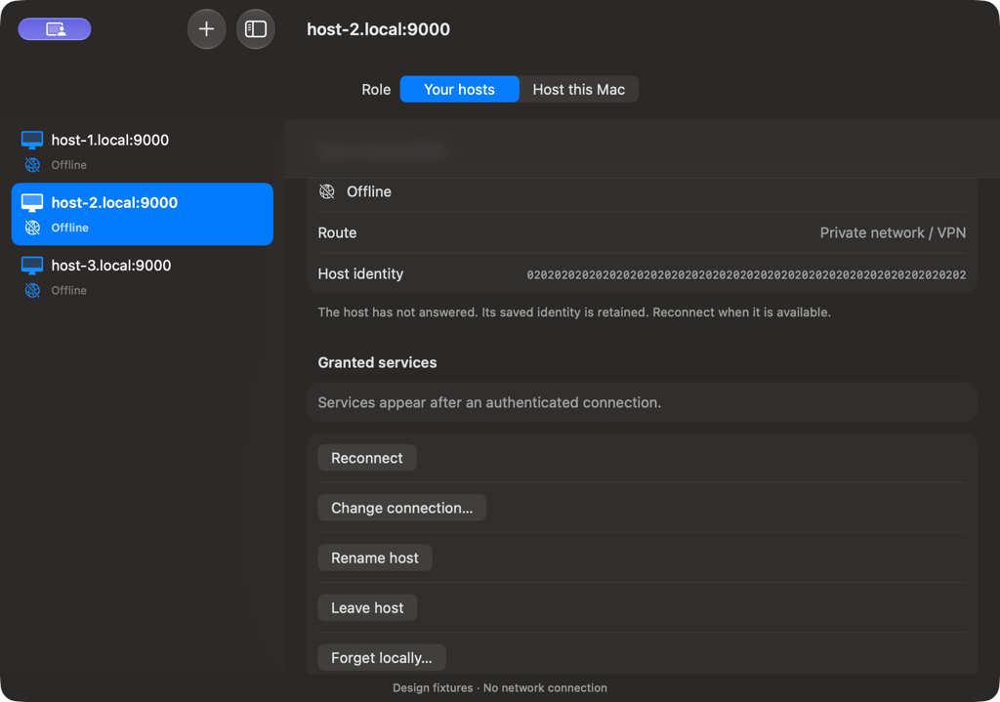

# Tether

[](https://github.com/fledgeling-co/tether/actions/workflows/ci.yml) [](LICENSE)

**Native companion connections. Your host keeps the data.**

Tether connects iOS, Android, macOS and Windows apps to services on a paired Mac or Windows host. Embed the transport alone or add native pairing and connection controls. Users explicitly choose their private network/VPN or a cloud relay. The relay forwards ciphertext; your host serves the data and controls device permissions.

This is a pre-release SDK, not a hosted relay service. [Security boundaries](SECURITY.md) and [what has been verified](docs/VALIDATION.md) apply to every integration.

[How Tether works](docs/how-tether-works.html) walks through the roles, pairing, every later connection, storage and the Tailscale work in progress, with diagrams.

## Native in your app

| Platform | Transport | Optional native UI | Role |
| --- | --- | --- | --- |
| macOS 14+ | Swift `TetherKit` | SwiftUI `TetherUI` | Host and client; Apple Silicon and Intel |
| iOS 17+ | Swift `TetherKit` | SwiftUI `TetherUI` | Companion client; arm64 device and Apple Silicon simulator |
| Android API 26+ | Kotlin `tether-core` with JNI | Material 3 Compose `tether-ui` | Companion client; arm64-v8a and x86_64 |
| Windows x64 | .NET `Tether.Core` | WinUI `Tether.WinUI` | Host and client; .NET 10 example |

UI components follow the host app's native theme and remain separate from transport. SwiftUI can sit inside UIKit or AppKit; Compose can sit inside an Android View; WinUI controls fit an existing window. Pairing, host selection, offline state, reconnect, route changes and removal work as embedded flows rather than requiring a separate application.



The screenshot uses synthetic offline hosts. [Native UI examples and embedding details](docs/NATIVE_UI.md) distinguish native captures from design previews.

## Start with your platform

### Apple

Add the GitHub repository as a Swift package, then select `TetherKit` and optionally `TetherUI`:

```swift
.package(url: "https://github.com/fledgeling-co/tether.git",
         from: "0.1.0-preview.1")
```

```swift
let client = try TetherClient(appID: "com.example.companion")
let connections = try TetherConnectionStore(client: client)
TetherWorkspaceView(store: connections)
```

Keep the client and store for the owning scene's lifetime. Configure your app's Keychain access group before pairing. The optional `TetherDuoUI` adapter requires the iOS 27.1 SDK; standard `TetherUI` does not. [Apple integration](docs/FRAMEWORKS.md).

### Android

Build or embed the `packages/android` modules. `tether-core` has no Compose dependency; add `tether-ui` when you want the native controls:

```kotlin
val client = TetherClient(context, "com.example.companion")
val connections = TetherConnectionStore(client)
// Inside your MaterialTheme:
TetherWorkspace(store = connections)
```

Own these objects in a ViewModel or equivalent lifecycle owner and close the store when it is finished. Scanning is an optional app-supplied callback, so embedding Tether does not add a camera or barcode stack. [Android build and integration](docs/ANDROID.md).

### Windows

Use the Core and WinUI NuGets from [Releases](https://github.com/fledgeling-co/tether/releases), or build them from source:

```csharp
var client = new TetherClient("com.example.companion");
var connections = new TetherConnectionStore(client);
window.Content = new TetherClientView(connections);
```

Dispose the store and host controller asynchronously when the owning window closes. Your application supplies installer and distribution signing. [Windows integration](docs/WINDOWS.md).

## What travels through it

- Reliable byte streams for your host's APIs and other framed protocols.
- Bounded packet services for application-provided encoded audio/video.
- Independent simultaneous connections to several hosts.
- App-scoped pairing, pinned identities and host-owned service grants.
- Remote leave, local-only forgetting and host-side client revocation.

Private/VPN media uses QUIC datagrams. Cloud WebSocket packet forwarding is ordered and can stall behind TCP loss. Tether does not supply codecs, capture permissions, automatic route fallback or API-write replay. [Architecture](docs/ARCHITECTURE.md).

The core is native Rust, shared through a bounded C ABI. There is no embedded browser or JavaScript runtime. UI modules are optional, and apps package their required native architectures. [Build and install](docs/INSTALLING.md).

## Run a host or relay

Your host maps named services to fixed loopback targets. Clients cannot choose arbitrary destinations. Open a temporary pairing window on the host, then enter or scan its invitation in the client. Changing a saved route must authenticate the same pinned host.

The relay keeps bounded routing state in memory and stores no application data. It runs in a container deployment. It needs persistent connections; it cannot currently run unchanged as independent Vercel Functions. [Self-hosting](deploy/README.md).

A sleeping host is offline. The relay holds no cloud copy of application data. Noise/SPAKE2 composition and native lifecycle code have not received a professional cryptographic audit. Report vulnerabilities [privately](https://github.com/fledgeling-co/tether/security/advisories/new).

## Authenticated MCP data access

The source-built [Tether MCP package](packages/mcp/README.md) exposes account-authorized service data over HTTP MCP. It includes a PageIndex adapter, per-user sharing checks and fixed Tether-forward transport. A host-provided identity verifier and current user grants are required; pairing alone grants no account access. [Integration and limits](docs/MCP.md).

## Contribute

See [CONTRIBUTING.md](CONTRIBUTING.md) for builds and checks. Tether is [MIT licensed](LICENSE); retain [third-party notices](THIRD_PARTY_NOTICES.txt) when distributing native artifacts.
