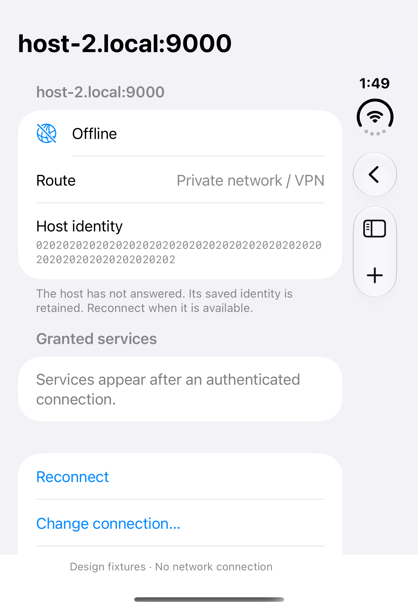
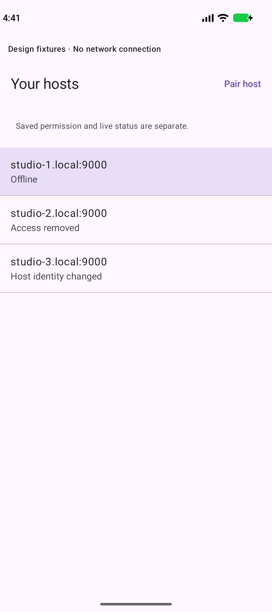
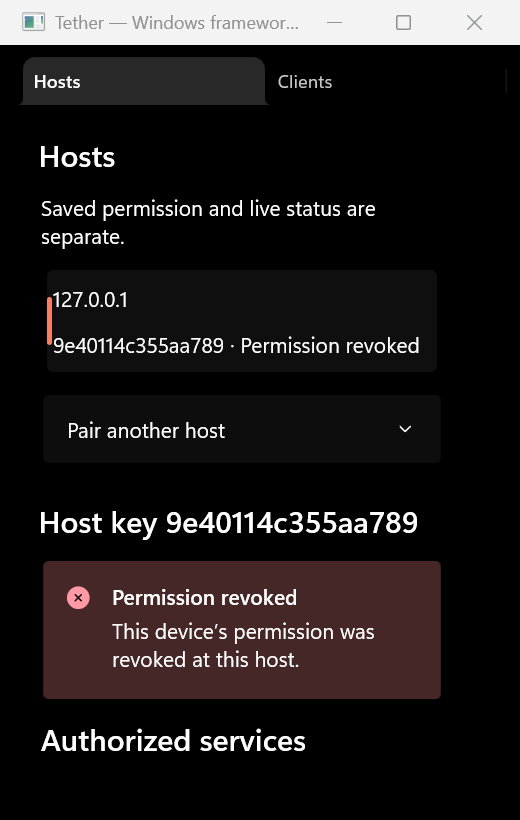
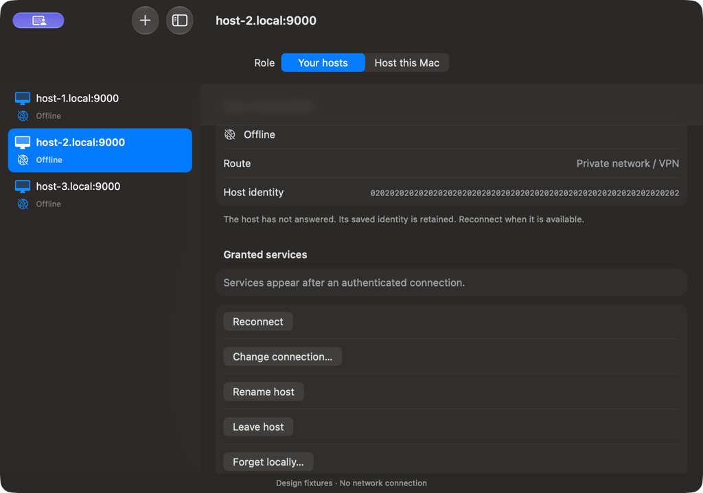
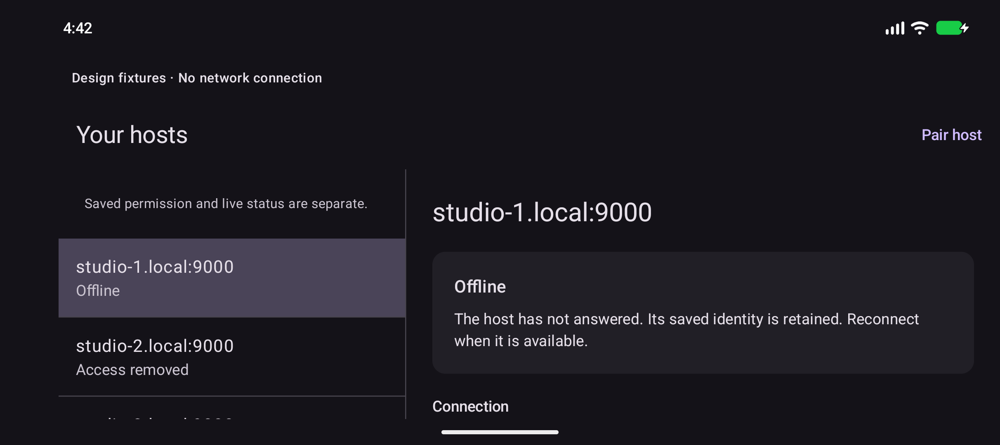

# Embed native connection UI

Tether UI manages connections and trust. Your app supplies the application content, authorized-service actions and any application-specific sign-in. Pairing a device does not replace API authorization, screen-capture permission or microphone permission.

## Components

| Platform | Workspace | Smaller surfaces | Existing-app integration |
| --- | --- | --- | --- |
| iOS/macOS | `TetherWorkspaceView` | `TetherPairHostView`, `TetherHostSettingsView` on Mac | SwiftUI, `UIHostingController`, `NSHostingView` |
| Android | `TetherWorkspace` | `TetherHostList`, `TetherHostDetail`, `TetherPairHost`, `TetherRouteEditor` | Compose or an Android `ComposeView` |
| Windows | `TetherWorkspaceView` | `TetherClientView`, `TetherHostView` | WinUI `ContentControl` or an existing window |

Pass an app-owned store into the controls. Creating or dismissing a screen should not recreate an identity, erase trust or interrupt another host. Selecting a host changes which details are shown; streams to other hosts remain independent. Native themes, typography and controls come from SwiftUI, Material 3 and WinUI rather than a cross-platform visual shell.

## Connection states

| State | What the user sees | Safe next action |
| --- | --- | --- |
| Empty | No paired hosts and a clear pairing action | Enter a host's route and current invitation |
| Connecting | Progress and cancellation | Cancel without deleting saved trust |
| Connected | Authenticated status and granted services | Open an app-provided service action |
| Offline | Saved host identity remains visible | Reconnect when the host is available |
| Pairing interrupted | Pending trust is identified | Recover or explicitly discard the pending record |
| Access removed | Host permission was revoked | Obtain a new owner-approved pairing |
| Identity changed | The new host key does not match | Keep existing trust and investigate |
| Host at capacity | A recoverable capacity error | Retry later; keep the identity |

Field labels stay visible after typing. A private address or cloud route is explicit; failure never selects another network mode. A saved route changes only after the same pinned host authenticates. Pairing invitations expire, and pairing codes are secrets: the UI should clear them after completion and avoid including them in diagnostics.

“Leave host” asks that host to revoke this device before removing the local record. “Forget locally” is available when remote revocation cannot complete and explains that the host may retain permission. Mac and Windows owner controls separately remove a client and close its services. Mobile clients do not display nonfunctional host-owner controls.

## Layout and lifecycle

Compact mobile windows show the host list and selected detail as separate destinations with a reachable host switcher. Wider windows can show them together. Android's optional scanner callback keeps camera/barcode choices in the embedding app; no Scan button appears when no scanner is supplied. SwiftUI's separate `TetherDuoUI` adapter supplies reserved-region geometry on the newer SDK; the base UI remains usable without it.

Keep client/store instances in the owning scene, ViewModel or window. Close streams on completion and release the store when the owner ends. Swift stores expose `stopMonitoring()` and per-host disconnect; Android stores implement `Closeable`; Windows stores and host controllers use asynchronous disposal. Follow the operating system's background execution rules. The SDK does not install a background service to keep an application alive.

## Native examples

These captures use synthetic fixture data and establish layout only. They do not demonstrate public networking or a real customer's account.

| iOS | Android | Windows |
| --- | --- | --- |
|  |  |  |

See [validation](VALIDATION.md) for the distinction between compilation, native checks and physical-device acceptance.
